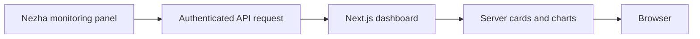

<div align="center">

# NezhaDash

**See your servers, follow their status.**  
*看见服务器，掌握运行状态。*


<p align="center">
  <a href="#features">核心特性</a> •
  <a href="#quick-start">快速上手</a> •
  <a href="#workflow">工作流程</a> •
  <a href="#structure">项目结构</a> •
  <a href="#documentation">文档导航</a>
</p>

[仓库主页](https://github.com/langesmesser/nezha-dash)

</div>

---

<a name="overview"></a>

## 项目简介

基于 Next.js 与哪吒监控 API 的仪表盘，集中展示服务器状态，支持语言、主题、访问密码与展示项配置。

本仓库是 [hamster1963/nezha-dash](https://github.com/hamster1963/nezha-dash) 的 Fork。下方保留本分支现有指南与原作者来源；上游发行内容不等同于本分支构建产物。

---

<a name="features"></a>

## 核心特性

<table>
  <tr>
    <td width="50%" valign="top">
      <h3>服务器仪表盘</h3>
      <p>连接哪吒面板 API，展示服务器概览和状态卡片。</p>
    </td>
    <td width="50%" valign="top">
      <h3>多语言与主题</h3>
      <p>提供英语、简体中文、繁体中文和日语文本，以及明暗主题。</p>
    </td>
  </tr>
  <tr>
    <td width="50%" valign="top">
      <h3>展示配置</h3>
      <p>按需设置旗帜、标签、流量、标题、Logo 与刷新间隔。</p>
    </td>
    <td width="50%" valign="top">
      <h3>部署选择</h3>
      <p>现有指南提供 Vercel、Docker 与 Cloudflare 的部署入口。</p>
    </td>
  </tr>
</table>

---

<a name="workflow"></a>

## 工作流程



---

<a name="quick-start"></a>

## 快速上手

按下方指南选择与你的系统、客户端或部署方式相符的入口。安装与发行地址沿用本分支现有说明。

<a name="usage-guide"></a>

## 完整使用指南

| 一键部署到 Vercel-推荐                                | Docker部署                                                      | Cloudflare部署                                                               | 如何更新？                                                |
| ----------------------------------------------------- | --------------------------------------------------------------- | ---------------------------------------------------------------------------- | --------------------------------------------------------- |
| [部署简易教程](https://buycoffee.top/blog/tech/nezha) | [Docker 部署教程](https://buycoffee.top/blog/tech/nezha-docker) | [Cloudflare 部署教程](https://buycoffee.top/blog/tech/nezha-cloudflare)      | [更新教程](https://buycoffee.top/blog/tech/nezha-upgrade) |
| [Vercel-demo](https://nezha-vercel.buycoffee.top)     | [Docker-demo](https://nezha-docker.buycoffee.tech)              | [Cloudflare-demo](https://nezha-cloudflare.buycoffee.tech) [密码: nezhadash] |

##### 环境变量

| 变量名                         | 含义                     | 示例                                                          |
| ------------------------------ | ------------------------ | ------------------------------------------------------------- |
| NezhaBaseUrl                   | nezha 面板地址           | http://120.x.x.x:8008                                         |
| NezhaAuth                      | nezha 面板 API Token     | 5hAY3QX6Nl9B3Uxxxx26KMvOMyXS1Udi                              |
| SitePassword                   | 页面密码                 | **默认**：无密码                                              |
| DefaultLocale                  | 面板默认显示语言         | **默认**：en [简中:zh 繁中:zh-t 英语:en 日语:ja]              |
| ForceShowAllServers            | 是否强制显示所有服务器   | **默认**：false                                               |
| NEXT_PUBLIC_NezhaFetchInterval | 获取数据间隔（毫秒）     | **默认**：2000                                                |
| NEXT_PUBLIC_ShowFlag           | 是否显示旗帜             | **默认**：false                                               |
| NEXT_PUBLIC_DisableCartoon     | 是否禁用卡通人物         | **默认**：false                                               |
| NEXT_PUBLIC_ShowTag            | 是否显示标签             | **默认**：false                                               |
| NEXT_PUBLIC_ShowNetTransfer    | 是否显示流量信息         | **默认**：false                                               |
| NEXT_PUBLIC_ForceUseSvgFlag    | 是否强制使用SVG旗帜      | **默认**：false                                               |
| NEXT_PUBLIC_CustomLogo         | 自定义Logo               | **示例**：https://nezha-cf.buycoffee.top/apple-touch-icon.png |
| NEXT_PUBLIC_CustomTitle        | 自定义标题               |                                                               |
| NEXT_PUBLIC_CustomDescription  | 自定义描述(无多语言支持) |                                                               |


---

<a name="structure"></a>

## 项目结构

```text
nezha-dash/
├── app/                    # Next.js 页面与接口
├── components/             # 服务器卡片与界面组件
├── messages/               # 多语言文本
├── auth.ts                 # 访问认证
├── docker/                 # 容器编排参考
└── .env.example            # 环境变量示例
```

---

<a name="documentation"></a>

## 文档导航

- [完整使用指南](#usage-guide)

---

<a name="contributing"></a>

## 参与贡献

反馈时请说明系统、版本、使用步骤、预期行为和脱敏日志。提交改动前核对相关指南与实际实现，并运行与改动有关的验证。

有关上游功能和发行的问题，可通过上方原作者入口反馈。

---

<a name="license"></a>

## 许可证与来源

本仓库未提供独立 LICENSE 文件；现有第三方组件与上游内容仍适用各自的许可和使用条款。

<div align="center">

### 项目活动

[](https://www.star-history.com/#langesmesser/nezha-dash&Date)

[贡献记录](https://github.com/langesmesser/nezha-dash/graphs/contributors)

</div>
